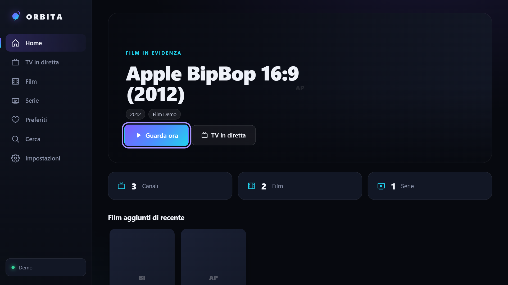
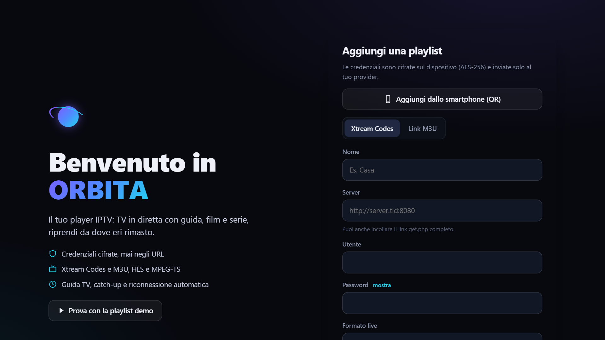
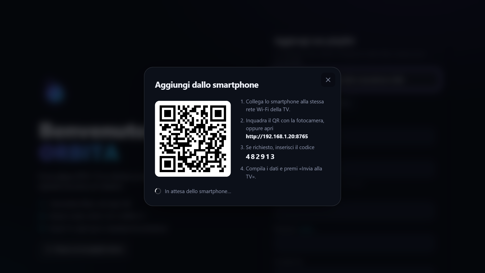
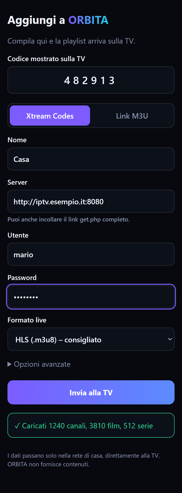
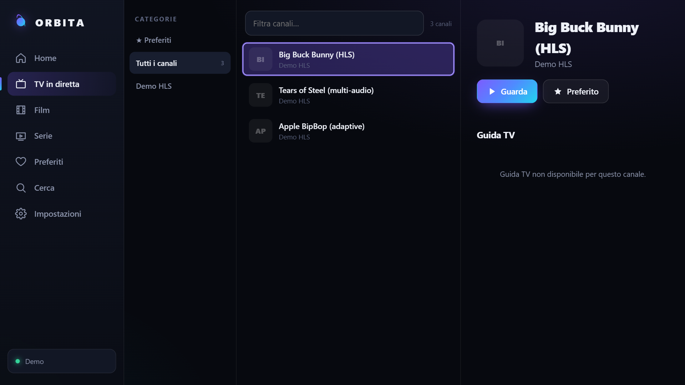

# ORBITA

Player IPTV per **Xtream Codes** e **M3U**: TV in diretta con guida e catch-up, film, serie, preferiti e "riprendi da dove eri".
Funziona su **Fire TV / Firestick**, **Android TV** e nel **browser** del PC.



> ORBITA non fornisce contenuti. Usa solo sorgenti che hai il diritto di guardare.

**Indice**
- [Per chi usa l'app](#per-chi-usa-lapp)
  - [Installazione su Fire TV / Firestick](#installazione-su-fire-tv--firestick)
  - [Installazione su Android TV](#installazione-su-android-tv)
  - [Aggiungere una playlist](#aggiungere-una-playlist)
  - [Usare l'app col telecomando](#usare-lapp-col-telecomando)
  - [Aggiornamenti](#aggiornamenti)
  - [Problemi frequenti](#problemi-frequenti)
- [Per chi sviluppa](#per-chi-sviluppa)

---

## Per chi usa l'app

### Installazione su Fire TV / Firestick

1. Dall'Appstore Amazon installa **Downloader** (di AFTVnews).
2. Vai su *Impostazioni → La mia Fire TV → Opzioni sviluppatore → Installa app sconosciute* e attiva **Downloader**.
   Se *Opzioni sviluppatore* non c'è: *Impostazioni → La mia Fire TV → Informazioni* e premi 7 volte su *Fire TV Stick*.
3. Apri Downloader, scrivi il codice **`6527602`** e premi **Go**.
4. Premi **Installa**, poi **Apri**.

Al posto del codice puoi usare l'indirizzo completo:
`https://github.com/ghows30/orbita/releases/latest/download/orbita.apk`

### Installazione su Android TV

Installa **Downloader** dal Play Store e segui gli stessi passi della Fire TV. In alternativa scarica `orbita.apk` dalla pagina [Releases](https://github.com/ghows30/orbita/releases/latest) e installalo con un file manager.

Serve Android 6 / Fire OS 6 o successivi.

### Aggiungere una playlist

Al primo avvio ORBITA chiede una playlist. Puoi inserire:

- **Xtream Codes**: server, utente e password. Puoi anche incollare il link `get.php` completo e i campi si compilano da soli.
- **Link M3U**: l'indirizzo della playlist (`.m3u` / `.m3u8`).
- In *Opzioni avanzate*: guida TV (XMLTV) e User-Agent, se il provider li richiede.



#### Dallo smartphone (consigliato sulla TV)

Scrivere indirizzi e password col telecomando è scomodo, quindi puoi compilare tutto dal telefono:

1. Sulla TV premi **Aggiungi dallo smartphone (QR)**.
2. Collega il telefono **alla stessa rete Wi-Fi** della TV.
3. Inquadra il QR con la fotocamera. Se non funziona, apri nel browser del telefono l'indirizzo mostrato sulla TV (es. `http://192.168.1.20:8765`) e inserisci il codice di 6 cifre.
4. Compila i dati e premi **Invia alla TV**. Il telefono ti dice se la playlist è stata caricata o cosa non va.

| Sulla TV | Sul telefono |
|---|---|
|  |  |

Il collegamento è attivo solo finché il QR è aperto sulla TV (massimo 15 minuti), accetta solo dispositivi della rete di casa e si blocca dopo 5 codici sbagliati. I dati viaggiano dentro la rete locale senza cifratura: usalo sulla Wi-Fi di casa, non su reti pubbliche.

Puoi aggiungere altre playlist o modificarle da **Impostazioni**.

### Usare l'app col telecomando



- **Frecce** per muoverti ovunque, **OK** per aprire o riprodurre.
- **Indietro** chiude la finestra aperta o torna alla Home; premuto due volte dalla Home esce dall'app.
- Durante la TV in diretta: **↑ / ↓** oppure **CH+ / CH−** cambiano canale.

Cosa trovi:
- **TV in diretta**: categorie, ricerca, preferiti, programma in corso e successivo, guida TV, catch-up ("Rivedi" / "Dall'inizio") se il provider lo supporta.
- **Film e serie**: categorie, ordinamento, schede con trama, stagioni ed episodi, episodio successivo automatico.
- **Riprendi**: film ed episodi ripartono da dove li avevi lasciati.
- **Controllo parentale**: le categorie per adulti si possono nascondere dietro un PIN.

### Aggiornamenti

Per aggiornare, ripeti l'installazione con lo stesso codice **`6527602`**: scarica sempre l'ultima versione e si installa sopra quella vecchia, senza perdere playlist e preferiti.

### Problemi frequenti

| Problema | Soluzione |
|---|---|
| Downloader non installa l'APK | Controlla di aver attivato *Installa app sconosciute* per Downloader. |
| Il QR non si apre sul telefono | Telefono e TV devono stare sulla stessa rete Wi-Fi (non la rete ospiti e non i dati mobili). Prova a scrivere l'indirizzo a mano. |
| "Codice errato" sul telefono | Usa il codice mostrato in quel momento sulla TV: cambia ogni volta che riapri il QR. |
| Playlist vuota o errore del provider | Controlla server, utente e password. Alcuni provider accettano solo certi player: prova a impostare uno User-Agent in *Opzioni avanzate*. |
| Un canale non parte | In una playlist Xtream prova a cambiare il *Formato live* (HLS ↔ MPEG-TS) dalle Impostazioni. |

---

## Per chi sviluppa

### Come è fatto

ORBITA è **una sola interfaccia web** (TypeScript + Vite, nessun framework) usata in due modi:

```
                   ┌────────────────────────────┐
                   │  Interfaccia web  (src/)   │
                   └─────────────┬──────────────┘
              ┌──────────────────┴──────────────────┐
     Browser del PC                         App Android / Fire TV (android/)
     server Node locale (server/)           WebView chiusa + ponte JavaScript (Bridge)
     proxy verso il provider                rete nativa (OkHttp) + player ExoPlayer
     http://127.0.0.1:7878                  server QR per lo smartphone (Remote.kt)
```

- Nel **browser** l'interfaccia parla con un piccolo server Node che fa da proxy sicuro verso il provider: credenziali mai negli URL, protezione SSRF, token opachi.
- Nell'**app Android** la stessa interfaccia gira in una WebView che carica solo gli asset dell'APK. Le chiamate di rete passano dal codice nativo e la riproduzione avviene in ExoPlayer, con decodifica hardware.
- `src/core/api.ts` sceglie da solo la strada giusta: se esiste `window.OrbitaAndroid` usa il ponte nativo, altrimenti il server Node.

### Requisiti

- **Node ≥ 20** per l'interfaccia web e il server.
- **JDK 17+** e **Android SDK** (compileSdk 36) solo per compilare l'APK.

### Avvio rapido

```bash
npm install
```

```bash
npm run dev
```

`npm run dev` avvia Vite su http://127.0.0.1:5173 con hot reload e il server su :7878. Per provare l'interfaccia senza un provider usa il pulsante **Prova con la playlist demo** ([public/demo.m3u](public/demo.m3u)).

### Script

| Comando | Cosa fa |
|---|---|
| `npm run dev` | Sviluppo: Vite + server con riavvio automatico |
| `npm start` | Build di produzione e server su http://127.0.0.1:7878 |
| `npm test` | Test (Vitest): parser M3U, Xtream con provider simulato, protezioni del server |
| `npm run build` | Controllo tipi + build in `dist/` |
| `npm run build:android-web` | Build dell'interfaccia dentro `android/app/src/main/assets/web/` |
| `npm run apk` | Interfaccia + APK release firmato (`android/app/build/outputs/apk/release/`) |

### Struttura

```
src/
  main.ts            router, navigazione col telecomando, avvio
  state.ts           stato dell'app: sorgenti, libreria, preferiti, cronologia
  styles.css         tutto lo stile (tema scuro, layout TV con body.tv)
  core/
    api.ts           chiamate di rete (server Node o ponte Android)
    m3u.ts           parser M3U
    xtream.ts        API Xtream Codes, link get.php, catch-up
    store.ts         IndexedDB cifrato (AES-GCM) e PIN
    types.ts, util.ts
  ui/
    dom.ts           costruzione DOM sicura, icone, toast, modali
    onboard.ts       benvenuto, form playlist, "Aggiungi dallo smartphone"
    library.ts       home, film, serie, ricerca
    live.ts          TV in diretta e guida
    player.ts        player web (hls.js, mpegts.js)
    settings.ts      impostazioni
server/
  index.mjs          server locale: file statici, API, token opachi, header di sicurezza
  net-guard.mjs      protezione SSRF, limiti di dimensione
  xmltv.mjs          parser EPG in streaming (.xml / .gz)
android/app/src/main/
  java/com/orbita/player/
    MainActivity.kt  WebView, ponte JavaScript (Bridge), origine interna
    PlayerActivity.kt  player ExoPlayer
    Remote.kt        server HTTP locale + QR per "Aggiungi dallo smartphone"
    Net.kt           rete verso i provider con protezione SSRF
    Xmltv.kt         parser EPG nativo
    BackKey.kt       tasto Indietro
  assets/remote.html pagina servita allo smartphone
tests/               test Vitest
docs/screenshots/    immagini del README
```

### Ponte JavaScript ↔ Android

Il ponte espone solo pochi metodi (`MainActivity.Bridge`), dichiarati in `NativeBridge` in [src/core/api.ts](src/core/api.ts):

| Metodo | Uso |
|---|---|
| `prepare(path, body)` | Registra una richiesta API; JS poi la esegue con `fetch('/__native/<id>')` |
| `play(json)` | Apre il player ExoPlayer |
| `isTv()`, `version()`, `exit()` | Informazioni e uscita |
| `remoteStart()`, `remoteStop()`, `remoteResult(ok, msg)` | Server per lo smartphone |

Il codice nativo richiama JavaScript con `window.orbitaBack()` (tasto Indietro), `window.orbitaPlayerClosed(json)` e `window.orbitaRemoteSource(json)` (playlist arrivata dal telefono). I dati arrivati dal telefono passano dalla stessa validazione del form (`buildSource` in [src/ui/onboard.ts](src/ui/onboard.ts)).

Se aggiungi un metodo al ponte, segnalo con `@JavascriptInterface` (la regola ProGuard in `proguard-rules.pro` lo mantiene nella build release) e rendilo facoltativo in `NativeBridge`, così l'interfaccia resta compatibile con gli APK più vecchi.

### Build dell'APK in locale

```bash
npm run apk
```

Per firmare con la chiave di rilascio crea `android/keystore.properties` (escluso da Git):

```properties
storeFile=orbita-release.jks
storePassword=...
keyAlias=...
keyPassword=...
```

Senza questo file l'APK release viene firmato con la chiave debug: va bene per provarlo, ma non si installa sopra la versione pubblicata.

> ⚠ Conserva una copia di `android/orbita-release.jks` e della password. Senza la stessa chiave gli aggiornamenti non si installano sopra l'app già presente.

### Pubblicare una nuova versione

```bash
git tag v1.2.0 && git push origin v1.2.0
```

GitHub Actions ([.github/workflows/release.yml](.github/workflows/release.yml)) compila l'interfaccia e l'APK, lo firma e lo pubblica nella Release come `orbita.apk`. Il link `releases/latest/download/orbita.apk`, e quindi il codice Downloader, punta sempre all'ultima versione.

Secret richiesti nel repository (*Settings → Secrets and variables → Actions*):

| Secret | Contenuto |
|---|---|
| `ORBITA_KEYSTORE_BASE64` | La keystore `orbita-release.jks` in base64 |
| `ORBITA_STORE_PASSWORD` | La password della keystore, usata anche per la chiave |

### Sicurezza

| Rischio | Come lo gestisce ORBITA |
|---|---|
| Credenziali su disco | Sorgenti e librerie cifrate **AES-GCM 256** in IndexedDB con chiave **non estraibile**. Nessun fallback in chiaro. |
| Password negli URL / log | Il browser riceve solo token opachi `/p/<token>`; le playlist HLS vengono riscritte. I log del server oscurano gli URL. |
| Altri siti che usano il proxy (CSRF) | Le API richiedono l'header `x-orbita` (impone un preflight CORS mai concesso), controllo di `Origin` e `Sec-Fetch-Site`. |
| DNS rebinding | Accettato solo `Host` uguale a `127.0.0.1`/`localhost` sulla porta giusta. Il server ascolta solo su loopback. |
| SSRF | Solo http/https; IP controllato **dopo** la risoluzione DNS e a ogni redirect. Bloccati loopback, link-local e metadata cloud; reti private bloccate nel browser (sbloccabili con `ORBITA_ALLOW_PRIVATE=1`) e ammesse sulla TV. |
| XSS da playlist malevole | DOM costruito solo con `textContent`, niente `innerHTML`; CSP restrittiva; URL `javascript:` scartati. |
| WebView Android | Carica solo l'origine interna degli asset; ogni altra navigazione è bloccata, il ponte non è mai esposto a pagine esterne. |
| Server per lo smartphone | Acceso solo con il QR aperto (max 15 min), solo client della rete locale, codice di 6 cifre con blocco dopo 5 errori, corpo max 32 KB, una playlist per sessione. |
| Risposte enormi | Limiti di dimensione e timeout su playlist, HLS, EPG (anche gzip) e immagini. |
| Controllo parentale | PIN con PBKDF2-SHA256 (210.000 iterazioni), confronto a tempo costante. |
