# ORBITA

An IPTV player for **Xtream Codes** and **M3U** playlists: live TV with a TV guide and catch-up, movies, series, favorites and "continue watching".
Runs on **Fire TV / Firestick**, **Android TV** and in your **PC browser**.

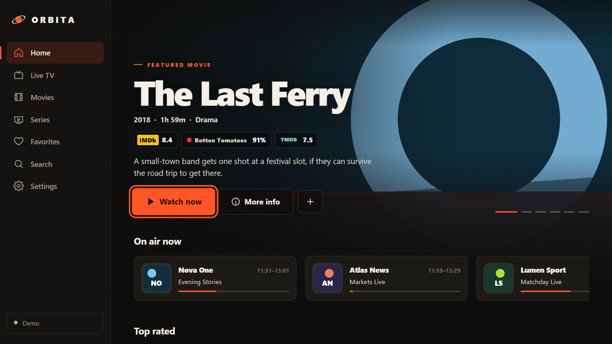

> ORBITA provides no content. Only use sources you have the right to watch.

**Contents**
- [Using the app](#using-the-app)
  - [Install on Fire TV / Firestick](#install-on-fire-tv--firestick)
  - [Install on Android TV](#install-on-android-tv)
  - [Add a playlist](#add-a-playlist)
  - [Find your way around](#find-your-way-around)
  - [Ratings and artwork (TMDB / OMDb)](#ratings-and-artwork-tmdb--omdb)
  - [Language and themes](#language-and-themes)
  - [Using the remote](#using-the-remote)
  - [Updates](#updates)
  - [Troubleshooting](#troubleshooting)
- [Development](#development)

---

## Using the app

### Install on Fire TV / Firestick

1. Install **Downloader** (by AFTVnews) from the Amazon Appstore.
2. Go to *Settings → My Fire TV → Developer options → Install unknown apps* and enable **Downloader**.
   If *Developer options* is missing: go to *Settings → My Fire TV → About* and click *Fire TV Stick* 7 times.
3. Open Downloader, type the code **`6527602`** and press **Go**.
4. Press **Install**, then **Open**.

Instead of the code you can type the full address:
`https://github.com/ghows30/orbita/releases/latest/download/orbita.apk`

### Install on Android TV

Install **Downloader** from the Play Store and follow the same steps as on Fire TV. Alternatively, download `orbita.apk` from the [Releases](https://github.com/ghows30/orbita/releases/latest) page and install it with a file manager.

Requires Android 6 / Fire OS 6 or later.

### Add a playlist

On first launch ORBITA asks for a playlist. You can enter:

- **Xtream Codes**: server, username and password. You can also paste the full `get.php` link and the fields fill themselves in.
- **M3U link**: the playlist address (`.m3u` / `.m3u8`).
- Under *Advanced options*: TV guide (XMLTV) and User-Agent, if your provider requires them.

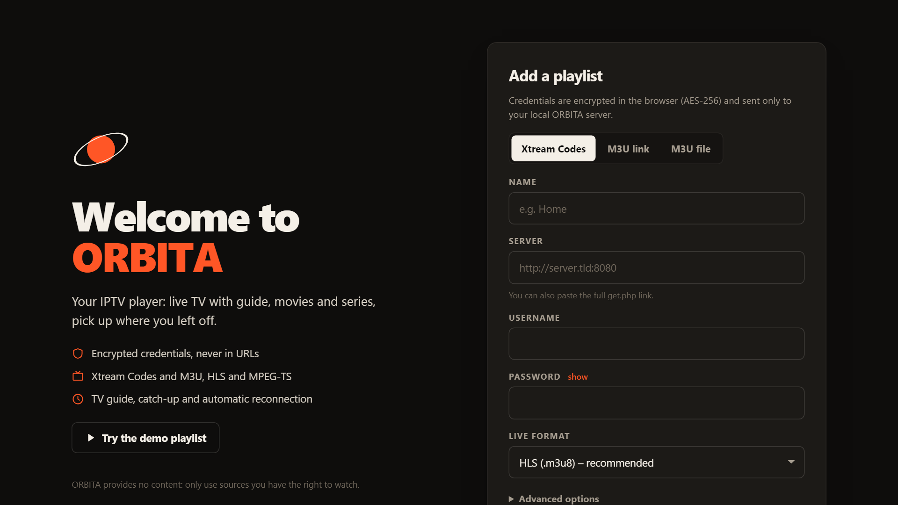

#### From your phone (recommended on TV)

Typing addresses and passwords with a remote is painful, so you can fill everything in on your phone:

1. On the TV, press **Add from your phone (QR)**.
2. Connect the phone **to the same Wi-Fi** as the TV.
3. Scan the QR code with the camera. If that doesn't work, open the address shown on the TV (e.g. `http://192.168.1.20:8765`) in the phone's browser and enter the 6-digit code.
4. Fill in the details and tap **Send to TV**. The phone tells you whether the playlist loaded or what went wrong.

| On the TV | On the phone |
|---|---|
| 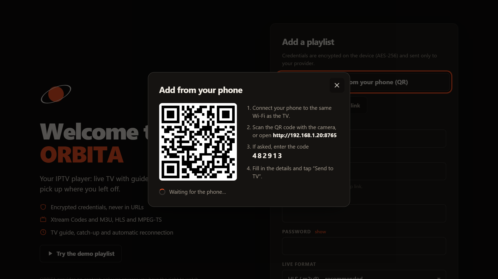 | 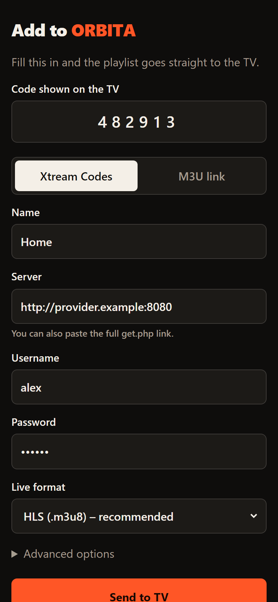 |

The link only works while the QR code is open on the TV (15 minutes at most), only accepts devices on your home network and locks after 5 wrong codes. Data travels unencrypted inside your local network: use it on your home Wi-Fi, not on public networks. The phone page uses the same language as the TV.

You can add more playlists or edit them from **Settings**.

### Find your way around

**Home**: a full-screen showcase rotates through featured movies and series with backdrop, ratings, genres and plot, followed by rows: continue watching, channels on air now (with the current programme), my list, top rated, recently added and the biggest genres.

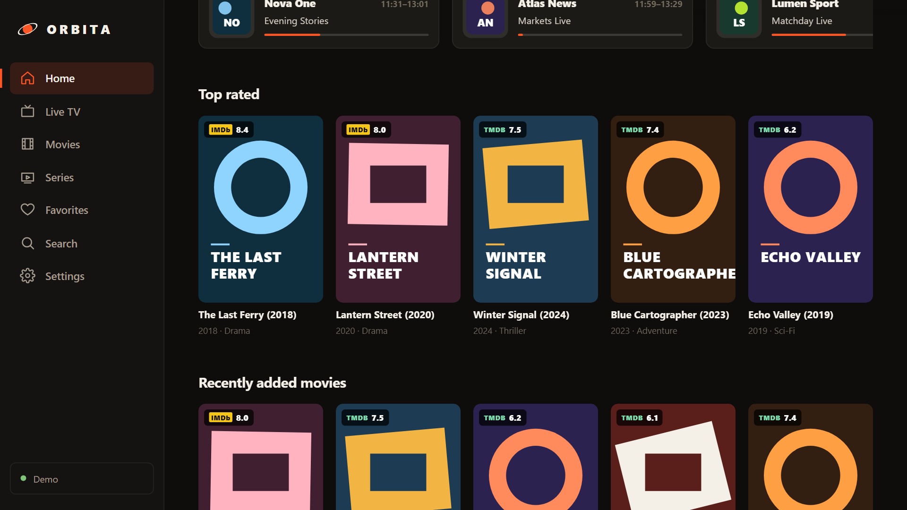

**Live TV**: categories, search, favorites, what's on now and next, a full TV guide, and catch-up ("Replay" / "From the start") when the provider supports it.

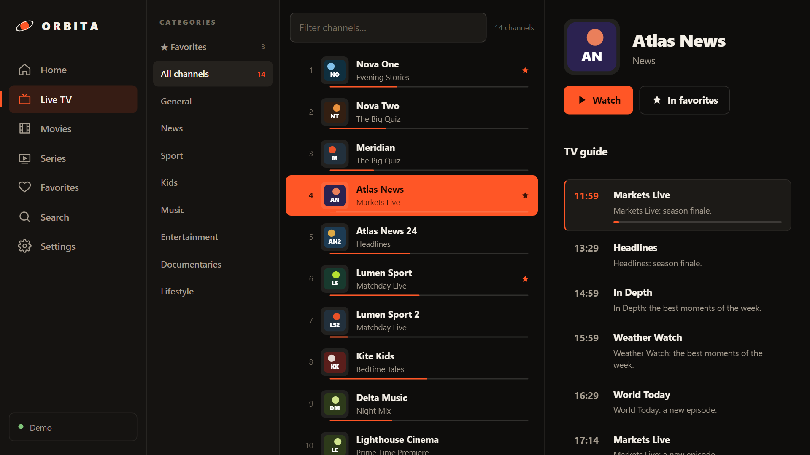

**Movies and series**: categories, sorting, detail pages with seasons and episodes, and automatic next episode. Movies and episodes resume where you left off.

| Movies | Series |
|---|---|
| 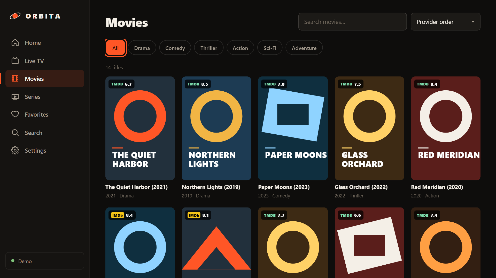 | 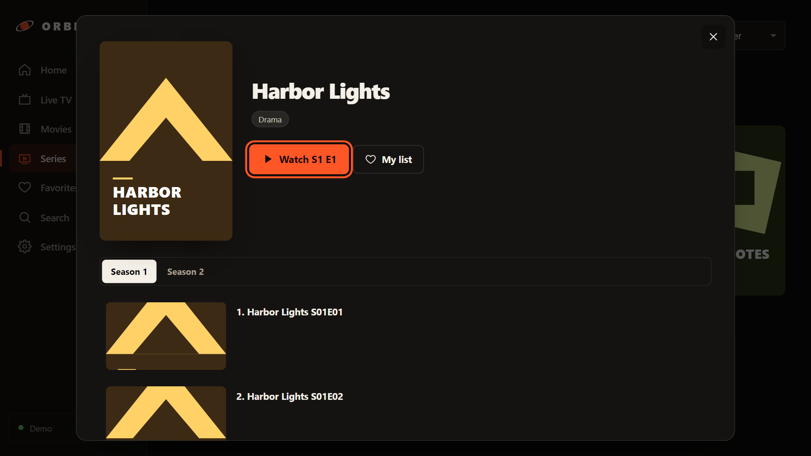 |

**Parental control**: adult categories can be hidden behind a PIN.

### Ratings and artwork (TMDB / OMDb)

ORBITA can show **IMDb**, **Rotten Tomatoes** and **TMDB** ratings, plus backdrops, genres, runtime and plots in your language. It's optional and uses free keys that you create yourself:

| Service | What it adds | Get a key |
|---|---|---|
| **TMDB** | Backdrops, posters for titles without one, plot in your language, genres, runtime, TMDB rating | Free account on [themoviedb.org](https://www.themoviedb.org/settings/api) → *Settings → API* (use the **API key**, v3) |
| **OMDb** | IMDb and Rotten Tomatoes ratings | Free key on [omdbapi.com](https://www.omdbapi.com/apikey.aspx) (1,000 requests a day) |

Paste the keys in **Settings → Ratings and artwork** and press **Check and save**: ORBITA tests them before saving and stores them encrypted on the device.

**On a TV**, typing a 32-character key with the remote is painful: press **Enter from your phone (QR)** in the same section, scan the code and paste the keys on your phone. It works like adding a playlist from the phone: same network, same 6-digit code. The TV checks the keys and tells the phone whether they were saved; a field left empty keeps the key already on the TV.

| On the TV | On the phone |
|---|---|
| 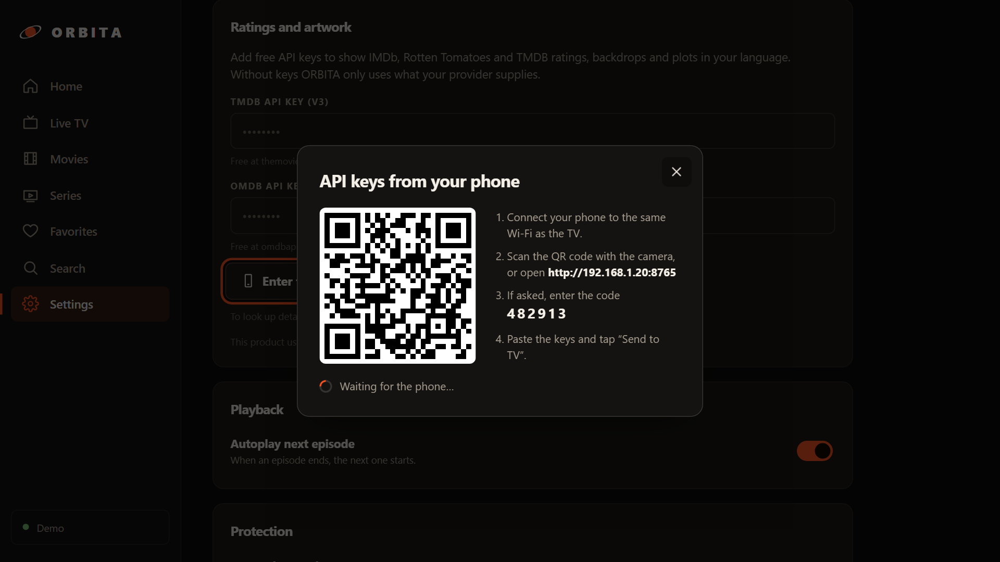 | 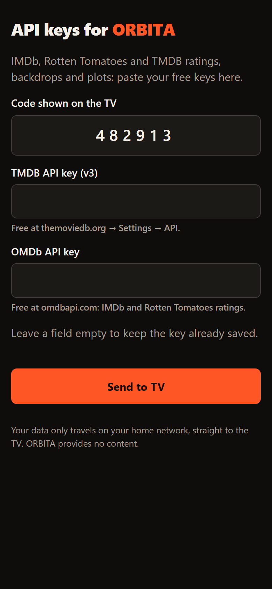 |

Without keys, ORBITA still uses what an **Xtream** provider supplies (rating, plot, backdrop). Results are cached on the device for three weeks, cards are only looked up when they appear on screen, and OMDb (which has a low daily limit) is only queried for the showcase and for detail pages.

| Settings | Movie detail |
|---|---|
| 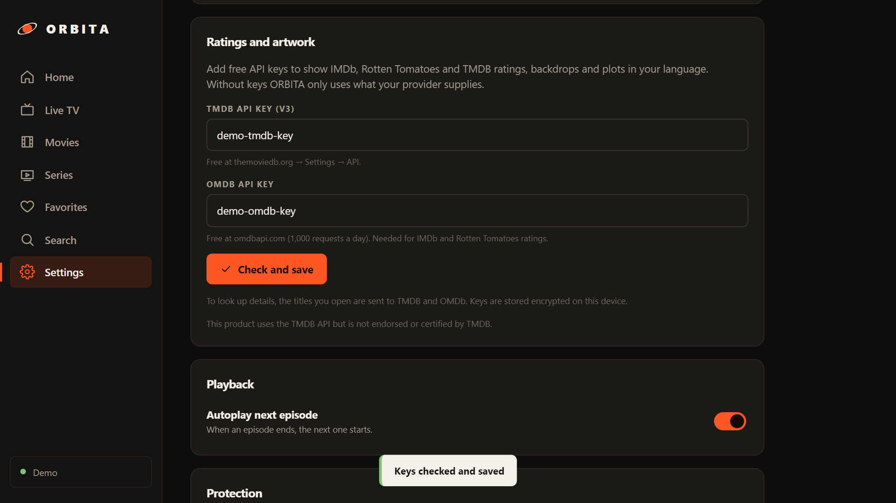 | 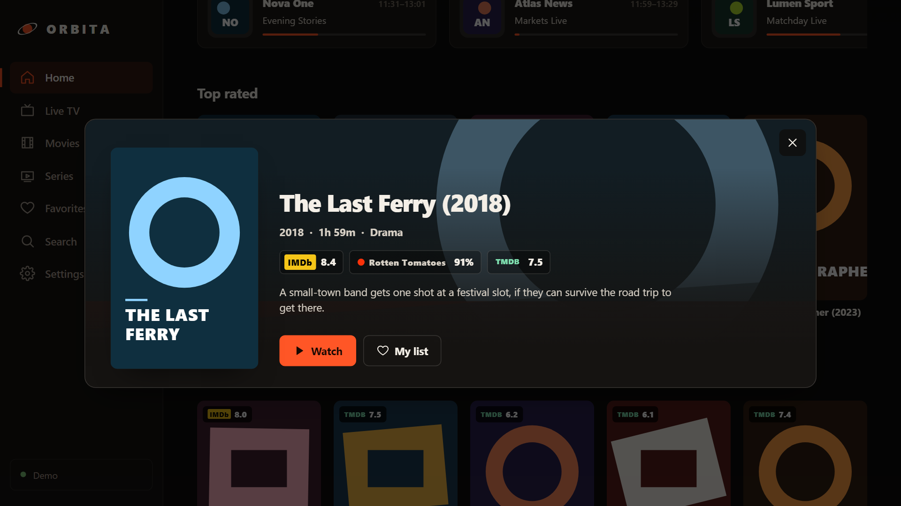 |

To look up details, the titles you browse are sent to TMDB and OMDb. *This product uses the TMDB API but is not endorsed or certified by TMDB.*

### Language and themes

In **Settings** you can switch the interface language and the color theme. Both changes apply instantly and are remembered on the device.

- **Languages**: English, Italiano, Español, Deutsch. On first launch ORBITA picks the language of the device (English if it isn't one of these four). The language also applies to the native player messages and to the phone page.
- **Themes**: three dark themes built for TV screens.

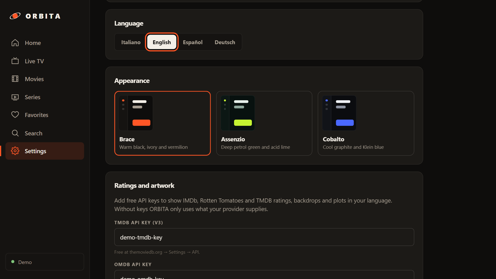

| Brace (default) | Assenzio | Cobalto |
|---|---|---|
|  | 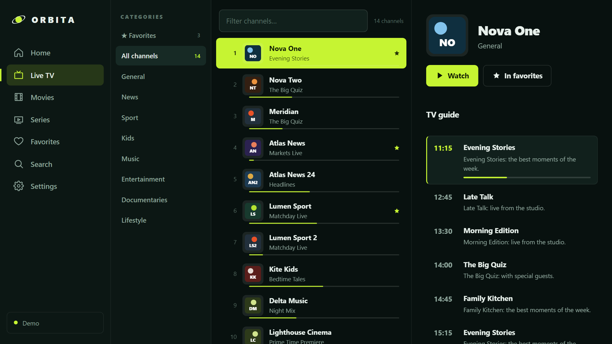 | 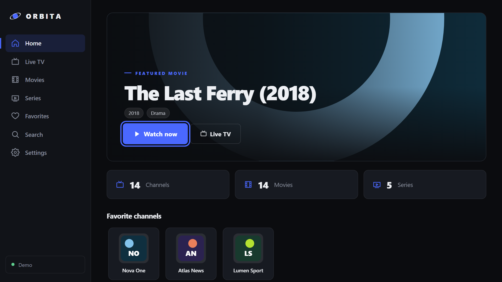 |
| Warm black, ivory and vermilion | Deep petrol green and acid lime | Cool graphite and Klein blue |

### Using the remote

- **Arrow keys** to move around, **OK** to open or play.
- **Back** closes the open window or returns to Home; pressed twice on Home it exits the app.
- While watching live TV: **↑ / ↓** or **CH+ / CH−** change channel.

In the browser: **Space** play/pause · **← / →** seek · **↑ / ↓** channel · **F** fullscreen · **I** audio, subtitles and quality · **L** channel list · **Esc** back.

### Updates

To update, repeat the installation with the same code **`6527602`**: it always downloads the latest version and installs it over the old one, keeping your playlists and favorites.

### Troubleshooting

| Problem | Solution |
|---|---|
| Downloader won't install the APK | Make sure *Install unknown apps* is enabled for Downloader. |
| The QR code doesn't open on the phone | Phone and TV must be on the same Wi-Fi network (not the guest network, not mobile data). Try typing the address by hand. |
| "Wrong code" on the phone | Use the code shown on the TV right now: it changes every time you reopen the QR. |
| Empty playlist or provider error | Check server, username and password. Some providers only accept certain players: try setting a User-Agent under *Advanced options*. |
| A channel won't start | For an Xtream playlist, try switching the *Live format* (HLS ↔ MPEG-TS) in Settings. |

---

## Development

### How it's built

ORBITA is **a single web interface** (TypeScript + Vite, no framework) used in two ways:

```
                   ┌────────────────────────────┐
                   │    Web interface  (src/)   │
                   └─────────────┬──────────────┘
              ┌──────────────────┴──────────────────┐
     PC browser                             Android / Fire TV app (android/)
     local Node server (server/)            locked WebView + JavaScript bridge
     proxy to the provider                  native networking (OkHttp) + ExoPlayer
     http://127.0.0.1:7878                  QR server for the phone (Remote.kt)
```

- In the **browser**, the interface talks to a small Node server that acts as a safe proxy to the provider: credentials never in URLs, SSRF protection, opaque tokens.
- In the **Android app**, the same interface runs in a WebView that only loads the APK's assets. Network calls go through native code and playback happens in ExoPlayer with hardware decoding.
- `src/core/api.ts` picks the right path automatically: if `window.OrbitaAndroid` exists it uses the native bridge, otherwise the Node server.

### Requirements

- **Node ≥ 20** for the web interface and the server.
- **JDK 17+** and the **Android SDK** (compileSdk 36), only to build the APK.

### Quick start

```bash
npm install
```

```bash
npm run dev
```

`npm run dev` starts Vite on http://127.0.0.1:5173 with hot reload, plus the server on :7878. To try the interface without a provider, use **Try the demo playlist** ([public/demo.m3u](public/demo.m3u)).

### Scripts

| Command | What it does |
|---|---|
| `npm run dev` | Development: Vite + server with automatic restart |
| `npm start` | Production build and server on http://127.0.0.1:7878 |
| `npm test` | Tests (Vitest): M3U parser, Xtream with a mocked provider, server protections, title matching for ratings |
| `npm run build` | Type check + build into `dist/` |
| `npm run build:android-web` | Build the interface into `android/app/src/main/assets/web/` |
| `npm run apk` | Interface + signed release APK (`android/app/build/outputs/apk/release/`) |

### Project layout

```
src/
  main.ts            router, remote-control navigation, startup
  state.ts           app state: sources, library, favorites, history
  i18n.ts            translations (it, en, es, de) and language choice
  styles.css         all styles: theme tokens ([data-theme]), TV layout (body.tv)
  core/
    api.ts           network calls (Node server or Android bridge)
    m3u.ts           M3U parser
    xtream.ts        Xtream Codes API, get.php links, catch-up
    meta.ts          ratings and artwork: Xtream, TMDB, OMDb, cache
    store.ts         encrypted IndexedDB (AES-GCM) and PIN
    types.ts, util.ts
  ui/
    dom.ts           safe DOM building, icons, toasts, dialogs
    onboard.ts       welcome screen, playlist form, "Add from your phone"
    home.ts          home: rotating showcase and rows
    library.ts       movies, series, search, detail pages, cards and ratings
    live.ts          live TV and TV guide
    player.ts        web player (hls.js, mpegts.js)
    settings.ts      settings, language and theme pickers
    theme.ts         theme list and startup application
server/
  index.mjs          local server: static files, API, opaque tokens, security headers
  net-guard.mjs      SSRF protection, size limits
  xmltv.mjs          streaming EPG parser (.xml / .gz)
android/app/src/main/
  java/com/orbita/player/
    MainActivity.kt  WebView, JavaScript bridge (Bridge), internal origin
    PlayerActivity.kt  ExoPlayer player
    Remote.kt        local HTTP server + QR for "Add from your phone"
    L10n.kt          native strings in the chosen language
    Net.kt           provider networking with SSRF protection
    Xmltv.kt         native EPG parser
    BackKey.kt       Back key handling
  assets/remote.html page served to the phone (translated by the TV's language)
tests/               Vitest tests
docs/screenshots/    README images
```

### Translations

All interface text lives in [src/i18n.ts](src/i18n.ts). Italian is the base dictionary; the other languages are typed against its keys, so a missing key fails the type check. Use `t('key', { placeholder })` in the UI. Error messages coming from the Node server or from native code are mapped to translated keys by `translateRemote`, which keeps the protocol compatible with APKs already installed.

Native text (player status, the Back toast, the phone server's errors) is in `L10n.kt`; the web interface passes the language with `setLang` and in the player request. The phone page (`remote.html`) carries its own small dictionary and reads the language the TV writes into `<html lang>`.

To add a language: add a dictionary in `i18n.ts` and an entry in `LANGS`, then the matching entries in `L10n.kt` and `remote.html`.

### Themes

Colors are defined only as CSS custom properties under `[data-theme="…"]` in [src/styles.css](src/styles.css); the rest of the stylesheet uses tokens. Because the selector also works on inner elements, the theme previews in Settings render each theme with its real colors. To add a theme, add a token block and an entry in `THEMES` ([src/ui/theme.ts](src/ui/theme.ts)) plus its description in `i18n.ts`.

### JavaScript ↔ Android bridge

The bridge exposes only a few methods (`MainActivity.Bridge`), declared in `NativeBridge` in [src/core/api.ts](src/core/api.ts):

| Method | Use |
|---|---|
| `prepare(path, body)` | Registers an API request; JS then runs it with `fetch('/__native/<id>')` |
| `play(json)` | Opens the ExoPlayer player |
| `isTv()`, `version()`, `exit()` | Device info and exit |
| `remoteStart()`, `remoteStartKeys()`, `remoteStop()`, `remoteResult(ok, msg)` | Server for the phone (playlist or API keys) |
| `setLang(lang)` | Language for native text and the phone page |

Native code calls back into JavaScript with `window.orbitaBack()` (Back key), `window.orbitaPlayerClosed(json)` and `window.orbitaRemoteSource(json)` (playlist received from the phone). Data from the phone goes through the same validation as the form (`buildSource` in [src/ui/onboard.ts](src/ui/onboard.ts)).

If you add a bridge method, annotate it with `@JavascriptInterface` (the ProGuard rule in `proguard-rules.pro` keeps it in the release build) and make it optional in `NativeBridge`, so the interface stays compatible with older APKs.

### Building the APK locally

```bash
npm run apk
```

To sign with the release key, create `android/keystore.properties` (ignored by Git):

```properties
storeFile=orbita-release.jks
storePassword=...
keyAlias=...
keyPassword=...
```

Without this file the release APK is signed with the debug key: fine for testing, but it won't install over the published version.

> ⚠ Keep a copy of `android/orbita-release.jks` and its password. Without the same key, updates won't install over the app already on the device.

### Publishing a new version

```bash
git tag v1.2.0 && git push origin v1.2.0
```

GitHub Actions ([.github/workflows/release.yml](.github/workflows/release.yml)) builds the interface and the APK, signs it and publishes it in the Release as `orbita.apk`. The `releases/latest/download/orbita.apk` link, and therefore the Downloader code, always points to the latest version.

Secrets required in the repository (*Settings → Secrets and variables → Actions*):

| Secret | Content |
|---|---|
| `ORBITA_KEYSTORE_BASE64` | The `orbita-release.jks` keystore in base64 |
| `ORBITA_STORE_PASSWORD` | The keystore password, also used for the key |

### Security

| Risk | How ORBITA handles it |
|---|---|
| Credentials on disk | Sources and libraries encrypted with **AES-GCM 256** in IndexedDB using a **non-extractable** key. No plain-text fallback. |
| Passwords in URLs / logs | The browser only receives opaque `/p/<token>` tokens; HLS playlists are rewritten. Server logs redact URLs. |
| Other sites using the proxy (CSRF) | The API requires the `x-orbita` header (forcing a CORS preflight that is never granted), plus `Origin` and `Sec-Fetch-Site` checks. |
| DNS rebinding | Only a `Host` of `127.0.0.1`/`localhost` on the right port is accepted. The server listens on loopback only. |
| SSRF | Only http/https; the IP is checked **after** DNS resolution and on every redirect. Loopback, link-local and cloud metadata are blocked; private networks are blocked in the browser (unlock with `ORBITA_ALLOW_PRIVATE=1`) and allowed on the TV. |
| XSS from malicious playlists | DOM built only with `textContent`, no `innerHTML`; strict CSP; `javascript:` URLs discarded. |
| Android WebView | Loads only the internal asset origin; any other navigation is blocked and the bridge is never exposed to external pages. |
| Phone server | On only while the QR is open (15 min max), local-network clients only, 6-digit code locking after 5 errors, 32 KB max body, one submission per session. |
| Huge responses | Size limits and timeouts on playlists, HLS, EPG (gzip included) and images. |
| Ratings services | Optional. TMDB/OMDb keys stored encrypted; requests go through the same proxy or native path as playlists, with results cached locally. |
| Parental control | PIN hashed with PBKDF2-SHA256 (210,000 iterations), constant-time comparison. |
